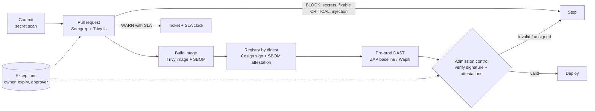

# RLogics security assessment: DevSecOps

A small, local, end-to-end security path built around a deliberately vulnerable Flask app. Everything runs on a Windows laptop without Docker; the Docker-dependent stages are written, but not yet run (see [Not completed](#not-completed)).

## Part A: What DevSecOps means to me

DevSecOps is an operating model, not a scanner list. Security checks run where developers already work, and each one returns a decision the developer can act on. The aim is to make the secure path the easy path, and to keep humans for the judgement calls.

**Who owns what.** Developers own the code and its dependencies, and fix findings in their own pull requests. The platform team owns the pipeline, the base images, the registry and the admission policy, so controls are consistent and not copied per repo. The security team owns the policy (what blocks, what warns, what needs an exception), the rules and the exception approvals. It also tracks risk across teams. Security writes the rules; the platform enforces them; developers get fast feedback.

**What happens at each stage.**
- *Commit:* pre-commit secret scan and linting, so leaks never reach the remote.
- *Pull request:* SAST (Semgrep), dependency and IaC scan (Trivy). Results appear as PR annotations and SARIF in code scanning. Only high-confidence, fixable issues block.
- *Build:* build the image from a pinned base, scan it, generate an SBOM (CycloneDX or SPDX).
- *Registry:* push by digest, sign (Cosign, keyless via OIDC), attach the SBOM and scan results as attestations. The registry keeps the evidence next to the artifact.
- *Deployment:* admission control (Kyverno or Sigstore policy-controller) verifies the signature, the signing identity and required attestations. Unsigned or unexpected artifacts are rejected. DAST runs against pre-production before promotion.

**Finding, gate, exception.** A *finding* is information: a tool says something may be wrong. A *build gate* is a policy decision: this class of finding stops the pipeline. An *exception* is a recorded, approved, time-boxed acceptance of risk for a finding that would otherwise block. Findings are cheap and plentiful; gates must be few and trusted; exceptions must be rare and expire. See [the decision table](devsecops/pipeline/GATE-DECISION-TABLE.md).

**False positives, accepted risk, SLAs.** A false positive is suppressed at the line (`# nosemgrep: rule-id -- reason`) or in a reviewed ignore file, with the reason and the reviewer in the PR. It is never suppressed globally to quiet a noisy rule; the rule is fixed instead. Accepted risk needs an owner, a justification, a compensating control, an expiry and an approver, and it is stored as data in the repo. Remediation SLAs depend on severity and exposure: for example, CRITICAL or known-exploited vulnerabilities in 7 days, HIGH in 14 to 30, MEDIUM in 90. A missed SLA escalates the finding to a block or to the risk owner.

**Evidence for assurance and audit.** For every release I would keep: the commit and PR with review approvals, SAST and dependency scan results (SARIF/JSON), the SBOM, the image digest, the signature and attestations, the DAST report, the policy version used for the gate, every active exception and who approved it, and the admission decision log. Retention follows the audit requirement (commonly 12 months or longer), in write-once storage, so that "what was shipped, who approved it and what we knew at the time" can be answered.

## Architecture and flow



## Repository layout

| Path | Purpose |
|---|---|
| `devsecops/app-or-lab-target/` | Intentionally vulnerable Flask app, `requirements.txt` and `Dockerfile` |
| `devsecops/remediation/` | Fixed versions of the same files (the "after") |
| `devsecops/sast/` | Semgrep rules and results |
| `devsecops/container-scan/` | Trivy results and the SBOMs |
| `devsecops/dast/` | Wapiti runner, ZAP plans (for when ZAP can be installed) and results |
| `devsecops/signing/` | Cosign script, public key, signature bundle and results |
| `devsecops/pipeline/` | Local pipeline script, decision table, gate summary, GitHub Actions workflow (copied to `.github/workflows/`) |

## Running it

```powershell
# One-time per terminal if script execution is disabled
Set-ExecutionPolicy -Scope Process Bypass -Force
.\devsecops\pipeline\run-local.ps1            # report mode
.\devsecops\pipeline\run-local.ps1 -Enforce   # exits 1 if any gate is BLOCK or REQUIRE EXCEPTION
.\devsecops\pipeline\run-local.ps1 -SkipDast  # skip the DAST stage
```

Tools used: Semgrep 1.180 (Python 3.12 venv), Trivy 0.75, Syft 1.52, Cosign 3.1.3, Wapiti 3 (own venv to avoid dependency conflicts).

<!-- RESULTS -->
