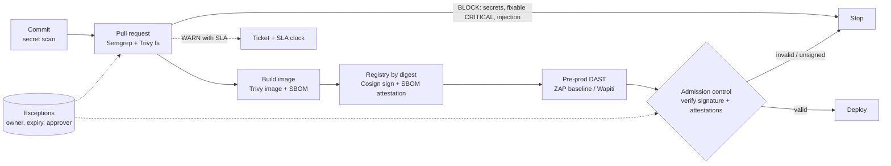

# RLogics security assessment: DevSecOps

A small, local, end-to-end security path built around a deliberately vulnerable Flask app. Everything runs on a Windows laptop without Docker; the Docker-dependent stages are written, but not yet run (see [Not completed](#not-completed)).

## Part A: What DevSecOps means to me

DevSecOps is an operating model, not a scanner list. Security checks run where developers already work, and each one returns a decision the developer can act on. The aim is to make the secure path the easy path, and to keep humans for the judgement calls.

**Who owns what.** Developers own the code and its dependencies, and fix findings in their own pull requests. The platform team owns the pipeline, the base images, the registry and the admission policy, so controls are consistent and not copied per repo. The security team owns the policy (what blocks, what warns, what needs an exception), the rules and the exception approvals. It also tracks risk across teams. Security writes the rules; the platform enforces them; developers get fast feedback.

**What happens at each stage.**
- *Commit:* pre-commit secret scan and linting, so leaks never reach the remote.
- *Pull request:* SAST (Semgrep), dependency and IaC scan (Trivy). Results appear as PR annotations and SARIF in code scanning. Only high-confidence, fixable issues block.
- *Build:* build the image from a pinned base, scan it, generate an SBOM (CycloneDX or SPDX).
- *Registry:* push by digest, sign (Cosign, keyless via OIDC), attach the SBOM and scan results as attestations. The registry keeps the evidence next to the artifact.
- *Deployment:* admission control (Kyverno or Sigstore policy-controller) verifies the signature, the signing identity and required attestations. Unsigned or unexpected artifacts are rejected. DAST runs against pre-production before promotion.

**Finding, gate, exception.** A *finding* is information: a tool says something may be wrong. A *build gate* is a policy decision: this class of finding stops the pipeline. An *exception* is a recorded, approved, time-boxed acceptance of risk for a finding that would otherwise block. Findings are cheap and plentiful; gates must be few and trusted; exceptions must be rare and expire. See [the decision table](devsecops/pipeline/GATE-DECISION-TABLE.md).

**False positives, accepted risk, SLAs.** A false positive is suppressed at the line (`# nosemgrep: rule-id -- reason`) or in a reviewed ignore file, with the reason and the reviewer in the PR. It is never suppressed globally to quiet a noisy rule; the rule is fixed instead. Accepted risk needs an owner, a justification, a compensating control, an expiry and an approver, and it is stored as data in the repo. Remediation SLAs depend on severity and exposure: for example, CRITICAL or known-exploited vulnerabilities in 7 days, HIGH in 14 to 30, MEDIUM in 90. A missed SLA escalates the finding to a block or to the risk owner.

**Evidence for assurance and audit.** For every release I would keep: the commit and PR with review approvals, SAST and dependency scan results (SARIF/JSON), the SBOM, the image digest, the signature and attestations, the DAST report, the policy version used for the gate, every active exception and who approved it, and the admission decision log. Retention follows the audit requirement (commonly 12 months or longer), in write-once storage, so that "what was shipped, who approved it and what we knew at the time" can be answered.

## Architecture and flow



## Repository layout

| Path | Purpose |
|---|---|
| `devsecops/app-or-lab-target/` | Intentionally vulnerable Flask app, `requirements.txt` and `Dockerfile` |
| `devsecops/remediation/` | Fixed versions of the same files (the "after") |
| `devsecops/sast/` | Semgrep rules and results |
| `devsecops/container-scan/` | Trivy results and the SBOMs |
| `devsecops/dast/` | Wapiti runner, ZAP plans (for when ZAP can be installed) and results |
| `devsecops/signing/` | Cosign script, public key, signature bundle and results |
| `devsecops/pipeline/` | Local pipeline script, decision table, gate summary, GitHub Actions workflow (copied to `.github/workflows/`) |

## Running it

```powershell
# One-time per terminal if script execution is disabled
Set-ExecutionPolicy -Scope Process Bypass -Force
.\devsecops\pipeline\run-local.ps1            # report mode
.\devsecops\pipeline\run-local.ps1 -Enforce   # exits 1 if any gate is BLOCK or REQUIRE EXCEPTION
.\devsecops\pipeline\run-local.ps1 -SkipDast  # skip the DAST stage
```

Tools used: Semgrep 1.180 (Python 3.12 venv), Trivy 0.75, Syft 1.52, Cosign 3.1.3, Wapiti 3 (own venv to avoid dependency conflicts).

## Part B: Results

All outputs are committed under each tool's `results/` folder. The pipeline's own verdict (report mode) from [gate-summary.txt](devsecops/pipeline/gate-summary.txt):

| Gate | Outcome | Reason |
|---|---|---|
| SAST ERROR findings | BLOCK | 3 ERROR (injection, secret) |
| SAST WARNING findings | WARN | 1 WARNING (debug mode) |
| Secret leakage | BLOCK | 1 secret found by Trivy |
| CRITICAL CVE, fix available | BLOCK | 1 (PyYAML) |
| HIGH CVE, fix available | WARN | 3 (Flask, Werkzeug); BLOCK if internet-facing |
| IaC / Dockerfile policy | WARN | 2 misconfigurations (runs as root) |
| SBOM present | PASS | CycloneDX and SPDX generated |
| Signature verification | PASS | valid accepted, tampered rejected |

### SAST: Semgrep ([results](devsecops/sast/results/))

Custom rules in [semgrep-rules.yml](devsecops/sast/semgrep-rules.yml). Four findings on the vulnerable app, for example:

```
devsecops.sast.lab.python.sql-string-formatting   (Blocking)
  SQL built with string formatting from request data; use parameterised queries.
   29┆ query = "SELECT id, name FROM users WHERE name = '%s'" % name
devsecops.sast.lab.python.subprocess-shell-true   (Blocking)
   36┆ return subprocess.check_output("ping -n 1 " + host, shell=True)
```

**One meaningful result.** The SQL injection in `/user` is reachable from a query-string parameter and gives an attacker read access to the database. Remediation is a parameterised query (see below). I would suppress a finding only when it is a verified false positive, using `# nosemgrep: lab.python.sql-string-formatting -- <reason>` on that line, with the reason and reviewer recorded in the PR. A suppression without a reason, or a global rule disable, would be rejected in review.

### Dependency, secret and IaC scan: Trivy ([results](devsecops/container-scan/results/))

Machine-readable: `trivy-fs.json`, `trivy-image.json`. Human summary: `trivy-fs.txt`, `trivy-image.txt`.

```
requirements.txt (pip)  Total: 4 (HIGH: 3, CRITICAL: 1)
 pyyaml   CVE-2020-14343  CRITICAL  5.3.1 -> fixed in 5.4
 flask    CVE-2023-30861  HIGH      2.0.1 -> 2.3.2, 2.2.5
 werkzeug CVE-2023-25577  HIGH      2.0.1 -> 2.2.3
 werkzeug CVE-2024-34069  HIGH      2.0.1 -> 3.0.3
Dockerfile  DS-0002 (HIGH): Specify at least 1 USER command with a non-root user
```

The image scan of `lab-app:local` reports 119 HIGH/CRITICAL findings in the Debian base layer on top of the Python packages.

### SBOM ([results](devsecops/container-scan/results/))

`sbom.cdx.json` (Trivy, CycloneDX), `sbom.spdx.json` (Syft, SPDX, source tree) and `sbom-image.spdx.json` (Syft, SPDX, image).

**Where it should live.** The SBOM belongs with the artifact it describes, not in the source repo. In production I would generate it at build time from the exact image, then attach it to the image digest in the registry as a signed attestation (`cosign attest --type spdxjson`). A copy goes to the evidence store and to an SBOM index (for example Dependency-Track), so "which services contain package X?" can be answered during an incident without pulling images.

### DAST: Wapiti ([results](devsecops/dast/results/))

ZAP could not be installed locally because Windows Defender blocked its installer (a common false positive for a pentest tool). Wapiti was used for the local run, and the ZAP baseline scan runs through its official container below. Wapiti ran an active scan on `127.0.0.1` only.

```
Command execution                          level 4   GET /ping  param=host
Content Security Policy Configuration      level 1   GET /ping
Clickjacking Protection                    level 1   GET /ping
MIME Type Confusion                        level 1   GET /ping
```

Wapiti confirmed the command injection at runtime, which Semgrep found statically. It did not detect the SQL injection in `/user` because that endpoint doesn't return a database error string Wapiti recognises. The two techniques complement each other, and neither replaces the other.

**Why active DAST needs authorisation.** An active scan sends real attack payloads: injection strings, command payloads and fuzzing. Against a system you don't own it is indistinguishable from an attack, and it may be illegal. Even against your own systems it can corrupt data, trigger alerts or cause an outage. It must run only against targets with written authorisation, ideally an isolated pre-production copy, with a defined scope and time window. Here the target is a throwaway local app bound to `127.0.0.1`.

### DAST: OWASP ZAP baseline ([results](devsecops/dast/results/))

The official ZAP container (`ghcr.io/zaproxy/zaproxy:stable`) ran `zap-baseline.py`, a passive scan with no attack payloads, against the lab image on `127.0.0.1:5000`. Reports: `zap-baseline.html`, `zap-baseline.json`, `zap-baseline.log`.

```
FAIL-NEW: 0   WARN-NEW: 7   INFO: 0   PASS: 60
Medium  Content Security Policy (CSP) Header Not Set
Medium  Missing Anti-clickjacking Header
Low     X-Content-Type-Options Header Missing
Low     Server Leaks Version Information via "Server" HTTP Response Header Field
Low     Permissions Policy Header Not Set
Low     Cross-Origin-Embedder/Opener/Resource-Policy headers missing or invalid
Info    Storable and Cacheable Content
```

Under the decision table, these are MEDIUM or informational DAST alerts, so they WARN and go to the hardening backlog; none blocks. The baseline is passive, so it did not find the injection flaws; Semgrep and Wapiti did. Its missing-header findings agree with Wapiti's CSP and clickjacking findings, which is useful corroboration.


### Signing and verification: Cosign ([results](devsecops/signing/results/))

Two demos, both using a lab-only key pair (`cosign.key` is git-ignored; `cosign.pub` is committed):

1. **Blob** (`lab-app.zip`): `sign-blob`, then `verify-blob` succeeds. A copy with one byte appended is rejected (`invalid signature`). See `cosign.txt`.
2. **Image by digest** in a local registry: `cosign sign` then `cosign verify` succeeds. An image that was never signed is rejected (`no signatures found`, exit 10). See `cosign-image.txt`.

The lab uses a local key with no transparency log. The key is simple to demonstrate, but it has to be stored, rotated and protected.

**Production image admission flow.**
1. CI builds the image and pushes it to the registry, then signs it **by digest** with keyless Cosign: the pipeline's OIDC identity gets a short-lived Fulcio certificate, and the signature is recorded in the Rekor transparency log. There is no long-lived key to steal.
2. CI attaches attestations to the same digest: the SBOM, the scan results and build provenance (SLSA).
3. The cluster runs an admission controller (Kyverno or Sigstore policy-controller). On every deploy it verifies that the signature exists, that the certificate identity and issuer match the expected CI workflow, and that the required attestations are present and pass policy.
4. Anything unsigned, signed by another identity, or missing an attestation is rejected. Allow-listed system images are the only exceptions, and they are recorded.
5. Rejections and admissions are logged and kept as audit evidence.

### Before/after: two remediations

[devsecops/remediation/](devsecops/remediation/) contains the fixed app. Results after the fix: Semgrep reports 0 findings, and Trivy filesystem reports 0 vulnerabilities and 0 Dockerfile misconfigurations ([trivy-after.txt](devsecops/remediation/results/trivy-after.txt)).

**1. SQL injection (CWE-89)**

```python
# before
query = "SELECT id, name FROM users WHERE name = '%s'" % name
return str(db().execute(query).fetchall())

# after
rows = db().execute("SELECT id, name FROM users WHERE name = ?", (name,)).fetchall()
return str(rows)
```

**2. OS command injection (CWE-78)**

```python
# before
return subprocess.check_output("ping -n 1 " + host, shell=True)

# after: validate, then pass an argument list with no shell
host = str(ipaddress.ip_address(request.args.get("host", "127.0.0.1")))
return subprocess.check_output(["ping", "-n", "1", host])
```

**Also fixed:** the hard-coded secret now comes from the environment, debug mode is off, dependencies are upgraded (`pyyaml 5.3.1 -> 6.0.2`, `werkzeug 2.0.1 -> 3.1.9`, `flask 2.0.1 -> 3.1.3`), and the Dockerfile runs as a non-root user on `python:3.12-slim`. The remediated image still has 44 HIGH findings from the Debian base layer. They need a base-image refresh or a distroless base, not an app change, and would be handled under the SLA table.

### Decision table

See [GATE-DECISION-TABLE.md](devsecops/pipeline/GATE-DECISION-TABLE.md). An example exception record is in [EXC-0001.example.yaml](devsecops/pipeline/exceptions/EXC-0001.example.yaml).

### How results reach developers

The [workflow](.github/workflows/devsecops.yml) uploads Semgrep and Trivy SARIF to GitHub code scanning, so findings show as PR annotations. A failing gate blocks the merge through branch protection. The evidence bundle (scan JSON, SBOM, DAST report) is stored as a workflow artifact with 90-day retention.

## Not completed

| Item | Reason | How I would complete it in production |
|---|---|---|
| Desktop ZAP install | Windows Defender blocked the ZAP installer as a false positive. I did not disable or bypass Defender. | Install ZAP from a managed, allow-listed source or run it only as a container on a scan runner. The ZAP baseline here ran through the official container instead. |
| Active ZAP scan | Only the passive baseline was run. The plan is in `devsecops/dast/zap-active.yaml` but not executed. | Run it against an isolated pre-production copy with written authorisation, scope and a time window. |
| Keyless Cosign signing and Rekor | Keyless needs an OIDC identity (CI) and a public transparency log. The lab used a local key with no tlog. | Sign in CI with the workflow's OIDC identity, record in Rekor, and verify identity and issuer in admission policy. |
| Admission controller | No Kubernetes cluster in the lab. The verify step stands in for it, and the flow is described above. | Deploy Kyverno or Sigstore policy-controller with a policy requiring signature, identity and SBOM attestation. |
| SBOM attestation and storage | SBOMs were generated but not attached to the image as attestations or sent to an SBOM index. | `cosign attest --type spdxjson` on the digest in CI, and ingest to Dependency-Track. |
| CI run on GitHub | The workflow is written but has not been run, because the repo is not pushed to GitHub. | Push the repo, enable branch protection with the `pr-checks` job required, and confirm SARIF appears in code scanning. |
| Registry stage | A local `registry:2` container stood in for a real registry. | Use a private registry with immutable tags, vulnerability re-scan on a schedule and retention policy. |
| Pre-commit secret scan | Not set up. Trivy found the planted secret at PR time only. | Add a pre-commit hook (for example gitleaks) plus server-side push protection. |
| Exception workflow | One example record exists, but nothing enforces expiry. | Have the pipeline read `exceptions/*.yaml`, apply them to matching findings and fail when `expires` has passed. |
| Base image CVEs | The remediated image still shows 44 HIGH findings from the Debian layer. | Rebuild on a patched or minimal base (distroless or Alpine), pin by digest and rebuild on a schedule. |
| SQL injection in DAST | Wapiti did not detect the SQL injection that Semgrep found. | Add an authenticated, schema-aware DAST scan and an API-spec-driven test, and keep SAST as the primary control. |
